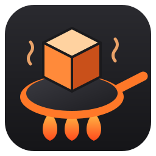

<p align="center"></p>

<h1 align="center">Fry3DX</h1>
<p align="center"><b>Frying 3D Extreme — a 3D modeller that does what you'd expect.</b><br>
Pick a tool, click, drag. On Windows, Linux and your phone.</p>
<p align="center">
  <a href="https://nexoniarz.github.io/Fry3DX/">Website</a> ·
  <a href="https://github.com/Nexoniarz/Fry3DX/releases">Download</a> ·
  <a href="#build-it-yourself">Build it</a> ·
  made by <a href="https://github.com/Nexoniarz">Nexoniarz</a>
</p>


## Why

Because the well-known modellers suck at being easy: a wall of panels, shortcuts nobody would
guess, modes inside modes. Fry3DX is built the way people think — a toolbox like GIMP's, plain
words on every button, tooltips everywhere — and keeps the useful parts (rounding, mirroring,
combining, holes for screws, checks for 3D printing) one click away.

And it works on a phone. Not a viewer: the whole modeller, with big buttons and fingers.

## Download

From [Releases](https://github.com/Nexoniarz/Fry3DX/releases):

| | |
|---|---|
| **Windows** (10 and 11, x64) | `Fry3DX-…-windows-x64.zip`: unpack, run `fry3dx.exe` |
| **Linux** (any distro from 2022 on, x64) | `Fry3DX-…-linux-x64.AppImage`: make it executable, run it. Or the `.tar.gz` |
| **Android** (8.0 and newer, 64-bit, Vulkan) | `Fry3DX-…-android-arm64.apk`: open it on the phone to install |

Needs a graphics card (or phone) with Vulkan; on a PC, OpenGL 4.6 works too.

## What it does

Five tabs along the top: **Model**, **Paint**, **Layout**, **Render**, **Print** (Ctrl+1 to 5).

**Making shapes**
- **Shapes that stay editable**: cube, rounded cube, plane, circle, cylinder, tube, cone, pyramid,
  sphere, capsule, torus, wedge, stairs, arch, and starter models (table, chair, shelf, barrel,
  bottle, pillar, door frame, crate). Their sizes stay changeable in Properties.
- **Draw shape** (D): click an outline on the ground, on a side view's plane, or straight on any
  face of another object: a new part standing on it, added to it, or cut into it.
- **Move, turn, scale** (W, E, R): the arrows turn with the object. Scale keeps the other side
  where it is; Shift scales both sides at once. Ctrl snaps.
- **Round, smooth, mirror** any object, changeable any time, baked in when you like.

**Editing the shape** (Tab, or double-click)
- Points, edges, faces (1, 2, 3). Extrude (X), inset (I), round edges (B), loop cut (C), knife (K),
  cut in four, smooth, merge (M), make a face, flip, separate (P).
- **Hole** (O): round (M2–M8 screw sizes ready), rectangle, triangle or hexagon (M2–M8 nut
  sizes, with room for prints); all the way through, a pocket, or only its outline as a new face.
- **Selecting**: click, box, brush or lasso. Shift+click a whole loop, Shift+Ctrl+click an
  edge's ring, Ctrl+click adds or takes one.

**Whole objects** (the Object menu)
- **Add together, take one out of another, keep only where they overlap**: always closed, so
  always printable (Ctrl+Shift+ and Ctrl+Shift−).
- **Copies** in a row or round a circle; **make it thick** (a surface gets a back, a solid goes
  hollow); join objects; join flat faces.
- **Layers** with folders inside folders, drag and drop, hide and lock whole groups, and a button
  on every row that brings the camera to it.

**Painting**
- Paint on the model or on its flat picture. **Paste any picture** (Ctrl+V): it goes on like a
  sticker that bends over edges and corners; Enter locks it as a layer, clicking it in the
  Picture panel unlocks it again.
- **Layout tab**: move, turn and size the flat frames of the surface yourself; the paint follows.

**Seeing it**
- **Solid** view for modelling, **Rendered** with a real sky, sun and soft shadows (Z). Wireframe
  (Shift+Z), X-ray (Alt+Z). The Render tab: the sun, sky, ground, brightness, shadows, glow;
  F12 saves a picture of just the view.

**3D printing** (the Print tab)
- Your printer's plate in the view (Prusa, Bambu, Creality, Elegoo, Anycubic, or your own),
  sizes in millimetres, checks for holes and flipped faces with buttons that fix them, overhangs
  in red, weight and filament, measuring, lay flat on a face, save 3MF or STL.

**Files**
- `.fry`: Fry3DX's own file, everything in one, packed small. **Autosave** in the background,
  offered back after a crash; Save / Don't save / Cancel when closing.
- **Export**: GLB, glTF, FBX (Blender, Unity, Unreal, Maya), OBJ, 3MF, STL, PLY.

**On a phone or tablet**: everything bigger, the side panels when you want them, a bar of big
buttons (undo, redo, Shift and Ctrl that stay down, edit the shape, delete, frame). One finger
turns the view (or drags the arrows), two fingers move it and pinch to zoom, holding a finger
still is a right-click. Files open and save through the phone's own file picker.

F1 in the app lists every key.

## Build it yourself

Everything it uses is downloaded while building; you need CMake 3.25+, Ninja, a C++20 compiler
(GCC 13+, Clang 17+ or clang-cl) and glslc (from shaderc or the Vulkan SDK). On NixOS,
`shell.nix` has it all.

```sh
git clone https://github.com/Nexoniarz/Fry3DX.git && cd Fry3DX
cmake --preset release && cmake --build build/release      # (NixOS: inside nix-shell)
build/release/bin/fry3dx [file.fry]
cmake --build build/debug --target check                     # the tests (after --preset debug)
```

| Preset | What |
|---|---|
| `debug`, `release` | for working on it |
| `portable` | a Linux build to hand out: SDL and the C++ library inside the program |
| `windows` | Windows, cross-built from Linux with clang-cl ([how](cmake/toolchains/windows-msvc.cmake)) |
| `android` | the Android library; `android/build_apk.py` makes the APK ([how](android/build_apk.py)) |

`tools/package.py` packs builds into the downloads (zip, tar.gz, AppImage). Pushing a tag
`v*` makes GitHub build all of them and put them in a release (`.github/workflows/build.yml`).

## What's where

| | |
|---|---|
| `src/app.cpp` | the app: panels, tools, the view, touch |
| `src/mesh.*`, `tools.cpp`, `cut.cpp` | polygon meshes and the edits on them (tested without a window) |
| `src/boolean.cpp`, `modify.cpp` | combining shapes, thickness, joining flat faces |
| `src/shapes.*` | the shape library and starter models |
| `src/scene.*`, `package.cpp` | objects, folders, the `.fry` file |
| `src/export.cpp`, `print.cpp` | GLB/glTF/FBX/OBJ/3MF/STL/PLY, checks for printing |
| `src/uv.cpp`, `sticker.cpp`, `image.cpp` | flat layouts, stickers, pictures |
| `engine/` | window, Vulkan/OpenGL renderer, UI, files |
| `android/`, `tools/`, `.github/` | builds and packages |
| `docs/` | the website (GitHub Pages); its words are all in `docs/content.js` |
| `tests/` | `mesh_test` |

## Coming

Sculpting, materials shown in the view, scripting; animation later.

## Licence

[Apache License 2.0](LICENSE). Copyright 2026 Nexoniarz.
Sky pictures: Poly Haven, CC0. DejaVu fonts: their own free licence (`engine/fonts/LICENSE` in builds).
