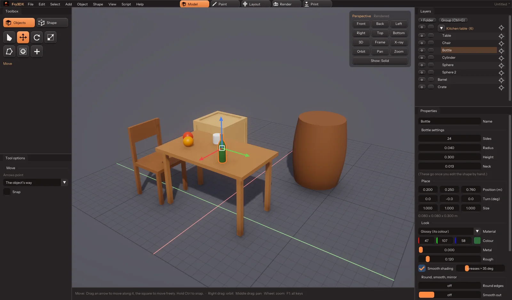

# Fry3DX — Frying 3D Extreme

**A 3D modeller that does what you'd expect: pick a tool, click, drag.**
Made by [Nexoniarz](https://github.com/Nexoniarz) · Website: https://nexoniarz.github.io/Fry3DX/

## Why

Because the well-known modellers suck at being easy: a wall of panels, shortcuts nobody would
guess, modes inside modes. Fry3DX is built the way people think — a toolbox like GIMP's, plain
words on every button, tooltips everywhere — and keeps the useful parts (rounding, mirroring,
combining, holes for screws, checks for 3D printing) one click away.

## Build and run

Linux, a Vulkan graphics card, CMake, Ninja, a C++20 compiler, glslc (shaderc) and SDL3.
Everything else is downloaded while building. On NixOS `shell.nix` has it all:

    git clone https://github.com/Nexoniarz/Fry3DX.git && cd Fry3DX
    nix-shell --run 'cmake --preset release && cmake --build build/release'
    build/release/bin/fry3dx [file.fry]
    nix-shell --run 'cmake --build build/debug --target check'   # tests

## What's in it (v0.4)

Five tabs at the top (Ctrl+1 to 5): **Model**, **Paint**, **Layout**, **Render**, **Print**.

- **Knife** (K, shape editing): click points along the cut (or drag a straight line; Ctrl for
  45° steps), Enter or double-click cuts. Only what you see, or **right through**; then just the
  edges, pieces of one object, each piece its own object, or the smaller piece deleted — the
  inside **filled** (solid) or **left open** (hollow).
- **Hole** (O): press on a face, drag out the size (or type it in mm): round (any number of
  sides, screw sizes M2-M8 ready), rectangle (width and height), triangle, or hexagon (nut sizes
  M2-M8 ready, with a little room added for prints), turned as you like. All the way through, a
  pocket of a set depth, or **only the outline**: cut into the face as a new face, picked, ready
  to Extrude, Bevel or paint. Round edges then rounds its rim too.
- **Paint tab**: paint straight on the model (brush, eraser, fill, pick colour) or on its flat
  picture beside it; the surface is laid out flat by itself. **Paste a picture** (Ctrl+V, copied
  in GIMP or anywhere) or add one from a file, then drag its four corners to stretch and bend it
  into place — you see it on the model as you go — and Enter places it. Pictures save beside the
  .fry and go with the glTF export.
- **Pictures as layers**: a pasted picture goes onto the model as a **sticker** — drag it round
  the model and over a corner or edge it bends onto the next face like a real one; its corners
  size it (Shift stretches), the round handle turns it. Or put it on the flat picture and drag its
  corners. **Enter locks** it as a layer (listed in Properties: hide, reorder, delete, paint in for
  good); **clicking it in the Picture panel unlocks it** to move it again.
- **Files**: `.fry` is Fry3DX's own file — one file with the pictures and layers inside, packed
  small (pictures as colour planes of predicted differences, then zstd). Old text `.fry` files
  still open. **Autosave** (File > Autosave, every 2 minutes by default) keeps a highly packed
  copy in the background; after a crash it offers it back. Closing, New or Open with changes asks:
  **Save / Don't save / Cancel**.
- **Print tab** (Ctrl+5): your printer's plate drawn in the view (Prusa, Bambu, Creality,
  Elegoo, Anycubic, or your own size), the size in millimetres (type one in: it keeps its shape),
  fits or not, checks (holes, faces inside out, edges with more than two faces, faces with no
  size) with buttons that fix them, overhangs shown red, weight and filament from the material
  and infill, Measure (M), Lay flat on a face (L), Put on the bed (B), save 3MF / STL.
- **Object menu**: **add objects together, take one out of another, or keep only where they
  overlap** (the last picked is kept; Ctrl+Shift+ / Ctrl+Shift-), always closed and printable;
  **make copies** in a row or round in a circle (as objects or joined into one); **make it
  thick** (a surface gets a back, a closed shape goes hollow); join flat faces side by side.
- **Layers panel**: **folders** (+ Folder, or Ctrl+G groups the picked ones; folders inside
  folders; drag things onto them; a folder's eye and lock work on all in it; click it to pick all
  of it), a **go-to button** at the end of every row bringing the camera to it, right-click for
  rename, duplicate, show only this, move to a folder, delete.
- **Export** (Ctrl+E): GLB, glTF, **FBX** (Blender, Unity, Unreal, Maya; pictures inside), OBJ (+MTL), 3MF, STL (millimetres, for printing), PLY; painted
  pictures and their layers go with it.
 the sun (round, up, strength, colour), sky or a plain background, ground,
  brightness, soft shadows, shade in corners, glow, colour; Save a picture (F12) saves just the
  view, without panels or gizmos.

- **Toolbox like GIMP's**: picture buttons (hover for name and key), and *Tool options* under it.
- **Solid view** for modelling (plain grey room, studio light) and **Rendered** (real sky,
  sun and shadows) — Z switches; Shift+Z wireframe; Alt+Z X-ray.
- **Shapes with settings you can change after adding** (+ in the toolbox, or Add): cube, rounded
  cube, plane, circle, cylinder, tube, cone, pyramid, sphere, capsule, torus, wedge, stairs, arch;
  **starter models**: table, chair, shelf, barrel, bottle, pillar, door frame, crate.
- **Draw shape** (D): click an outline on the ground, a side view's plane, or **straight on any
  face of another object** → a new solid standing on it, added to it (raised), or cut into it.
- Move / Rotate / Scale (W/E/R): gizmos turn with the object (or the world's way, or — editing a
  shape — out of the faces). Scale has a handle on each side; by default the other side stays put
  (or the middle, the bottom, the origin); Shift scales both sides at once. Ctrl snaps.
- **Round, smooth, mirror** on any object, changeable any time: round every sharp edge, smooth it
  out like clay (keeping sharp edges if you want), mirror across X/Y/Z. Bake them when you like.
- **Shape editing** (Tab or double-click): points / edges / faces (1/2/3); extrude (X), inset (I),
  round edges (B), loop cut (C), cut in four, smooth, merge (M), make face, flip, separate (P).
- **Selecting**: click, box, brush or lasso; Shift+click (or Alt+click, double-click) a whole loop,
  Shift+Ctrl+click an edge for the ring across it, Ctrl+click adds or takes one; more/less,
  joined (L), invert, all/none.
- Join objects (Ctrl+J), reference pictures to trace over, layers (show, lock, rename).
- Undo / redo, `.fry` files, **export to glTF** (Ctrl+E), save a picture of the view (F12).
- F1 lists every key. If it ever crashes, its own crash screen offers to open it again, with the
  last autosave offered back.

## Coming

Sculpting, materials (metal/rough shown in the view), scripting; animation later.

## Layout

- `engine/` — Fry3DX's engine: window, Vulkan/OpenGL renderer, UI, files.
- `src/mesh.*`, `src/tools.cpp` — polygon meshes and the edits on them (no window needed; tested).
- `src/shapes.*` — the shape library and starter models.
- `src/icons.*` — the toolbox pictures.
- `branding/` — the logo (SVG, and PNGs made from it with Inkscape).
- `src/scene.*` — objects, folders, `.fry` text; `src/package.cpp` the packed `.fry`.
- `src/export.cpp` — GLB/glTF/FBX/OBJ/3MF/STL/PLY; `src/print.cpp` — print checks.
- `src/boolean.cpp`, `src/modify.cpp` — combining shapes, thickness, joining flat faces.
- `docs/` — the website (GitHub Pages). Its text is all in `docs/content.js`.
- `src/app.cpp` — the app.
